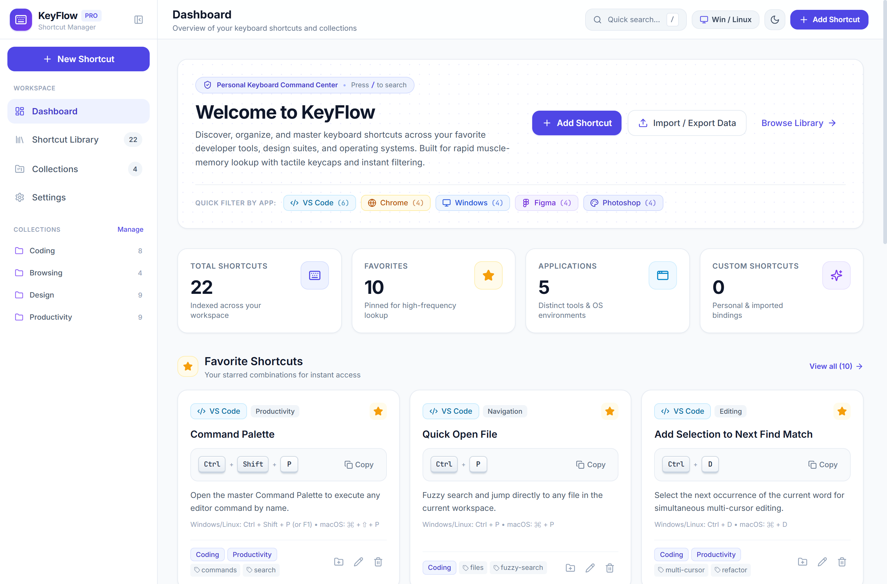
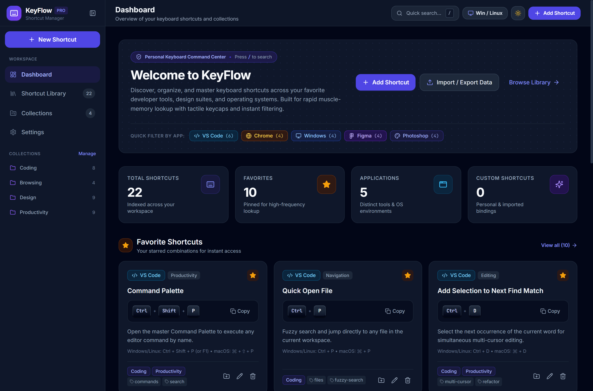
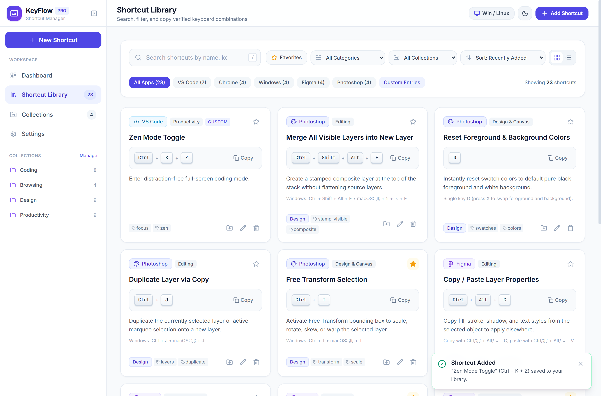
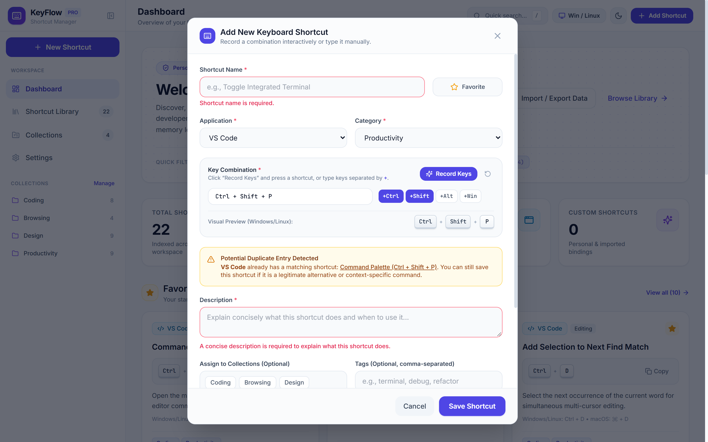
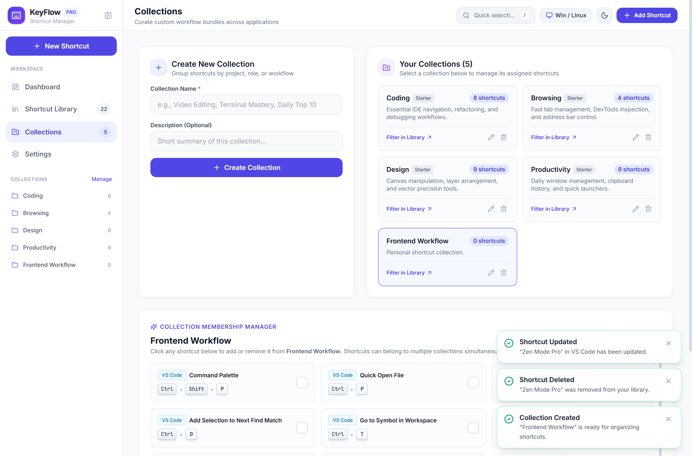
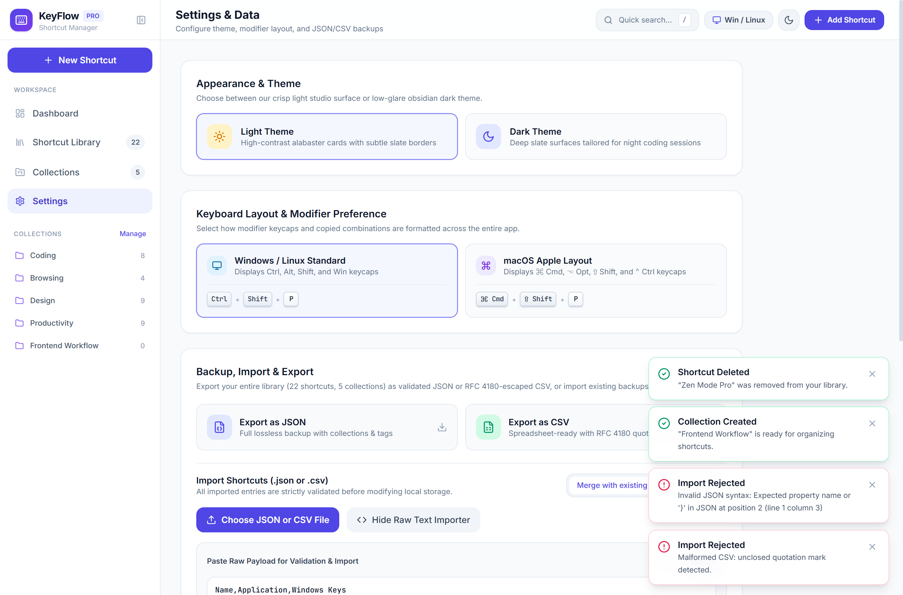
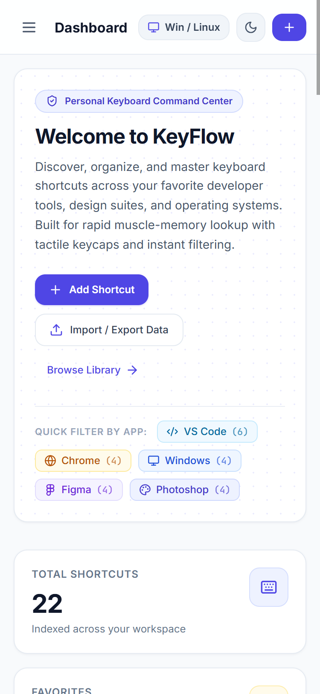

# KeyFlow — Personal Keyboard Shortcut Manager

[](https://saurav-96.github.io/KeyFlow/)
[](https://react.dev/)
[](https://tailwindcss.com/)
[](https://vite.dev/)

**KeyFlow** is a modern, local-first SaaS web application designed for developers, UI/UX designers, students, and power users to discover, organize, memorize, and manage keyboard shortcuts across applications.

🔗 **Live Website:** [https://saurav-96.github.io/KeyFlow/](https://saurav-96.github.io/KeyFlow/)  
📦 **GitHub Repository:** [https://github.com/saurav-96/KeyFlow](https://github.com/saurav-96/KeyFlow)

---

## ✨ Key Features

- **Tactile 3D Keycaps & Cross-Platform Modifiers**:
  - Realistic multi-bezel physical keycap components (`Ctrl + Shift + P` / `⌘ Cmd + ⇧ Shift + P`).
  - One-click global layout toggle between **Windows / Linux** (`Ctrl`, `Alt`, `Shift`, `Win`) and **macOS** (`⌘ Cmd`, `⌥ Opt`, `⇧ Shift`, `⌃ Ctrl`) modifiers.
- **Interactive Key Combination Recorder**:
  - Isolated keystroke listener active strictly inside the **Record Keys** widget in the Add/Edit modal.
  - Supports modifier combinations, `Escape` to cancel recording, `Backspace`/`Delete` to clear, manual text editing, and non-blocking warnings for browser-reserved combinations (`Ctrl + W`, `Ctrl + T`, `Alt + F4`).
- **Real-Time Duplicate Detection & Validation**:
  - Automatically warns when a shortcut combination or title already exists within the same application without blocking legitimate context-specific alternatives.
- **Instant Multi-Field Search & Filtering**:
  - Filter across shortcut names, descriptions, applications (`VS Code`, `Chrome`, `Windows`, `Figma`, `Photoshop`, or custom apps), categories (`Navigation`, `Editing`, `Productivity`, `Developer Tools`, `System`, `Design & Canvas`), tags, collections, and key combinations.
  - Switch seamlessly between **Grid View** (rich cards) and **List View** (dense SaaS data table) with pagination and 4 sort modes.
- **Personal Collections & Workflow Bundles**:
  - Includes 4 starter collections (**Coding**, **Browsing**, **Design**, **Productivity**).
  - Create, rename, and delete custom collections, and assign any shortcut to multiple collections simultaneously.
- **Validated JSON & RFC 4180 CSV Import / Export**:
  - Full lossless JSON backup and restore (supporting both **Merge** and **Replace** modes).
  - RFC 4180-compliant CSV export and import with proper escaping for commas, nested double quotes, and multiline descriptions.
- **100% Local-First Persistence & Privacy**:
  - Zero backend or external telemetry. All shortcuts, collections, and theme/layout preferences persist automatically in browser `localStorage`.

---

## 🛠 Technology Stack

| Layer | Technology | Purpose |
| :--- | :--- | :--- |
| **Framework** | [React 19](https://react.dev/) | Component architecture, hooks, and reactive UI state |
| **Build Tool** | [Vite 6](https://vite.dev/) | Lightning-fast HMR dev server and optimized ES module bundling |
| **Styling** | [Tailwind CSS 3](https://tailwindcss.com/) | Utility-first styling, dark mode (`class` strategy), custom keycap shadows |
| **Icons** | [Lucide React](https://lucide.dev/) | Crisp, consistent iconography |
| **Testing** | [Vitest](https://vitest.dev/) | Automated unit and integration testing for validation, filters, and CSV/JSON parsing |
| **Persistence** | Browser `localStorage` | Offline-capable client-side storage with schema validation |

---

## 📸 Screenshots

| View | Preview |
| :--- | :--- |
| **Dashboard (Light Mode)** |  |
| **Dashboard (Dark Mode)** |  |
| **Shortcut Library & Filters** |  |
| **Interactive Key Recorder & Modal** |  |
| **Collections Manager** |  |
| **Settings, Import/Export & Privacy** |  |
| **Mobile Responsive View** |  |

---

## 🚀 Getting Started & Setup Instructions

### Prerequisites
- **Node.js** `v18.0.0` or higher (`v20+` or `v24+` recommended)
- **npm** `v9+`

### 1. Clone the Repository
```bash
git clone https://github.com/saurav-96/KeyFlow.git
cd KeyFlow
```

### 2. Install Dependencies
```bash
npm install
```

### 3. Start the Development Server
```bash
npm run dev
```
Open [http://localhost:5173](http://localhost:5173) in your browser.

### 4. Run Automated Unit & Integration Tests
```bash
npm test
```

### 5. Build for Production
```bash
npm run build
```
Preview the production bundle locally:
```bash
npm run preview
```

---

## 🌐 Deployment Guide

KeyFlow compiles to a static, zero-dependency SPA bundle inside the `dist/` folder with relative asset paths (`base: './'`):

- **GitHub Pages**: Deployed directly from the `gh-pages` branch at [https://saurav-96.github.io/KeyFlow/](https://saurav-96.github.io/KeyFlow/).
- **Vercel / Netlify / Cloudflare Pages**: Connect the repository, set Build Command to `npm run build`, and set Output Directory to `dist`.

---

## ⚠️ Known Limitations & Safety Architecture

1. **Reference Repository Only (Not Global OS Key Hooks)**:
   - Because KeyFlow runs inside a sandboxed web browser, saved shortcuts serve as a personal reference and memory-training library. They do **not** override or register global system-level hotkeys in Windows, macOS, or third-party desktop applications.
2. **Browser-Reserved Key Combinations**:
   - Certain OS and browser window-management shortcuts (such as `Ctrl + W`, `Ctrl + T`, `Ctrl + N`, `Alt + F4`, or `Cmd + Q`) are intercepted by the browser or operating system before reaching web page DOM listeners. KeyFlow detects these combinations and provides quick modifier toggle buttons (`+Ctrl`, `+Shift`, `+Alt`, `+Win`/`+Cmd`) and manual input so you can still document them effortlessly.
3. **Browser-Scoped Storage (`localStorage`)**:
   - Data is stored locally per browser profile. To move your library across devices or browsers, use **Settings → Export as JSON** and import the file on your target device.

---

## 👤 Author

**Saurav Bhusal**  
Software & Web Developer • UI/UX Designer • Technical Analyst  
- **GitHub:** [@saurav-96](https://github.com/saurav-96)
- **LinkedIn:** [Saurav Bhusal](https://www.linkedin.com/in/saurav-b-502352415/)
